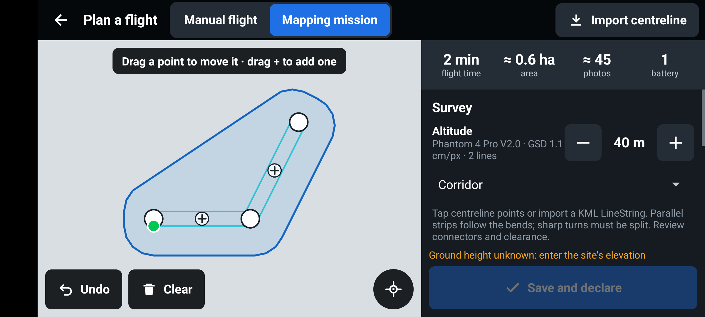
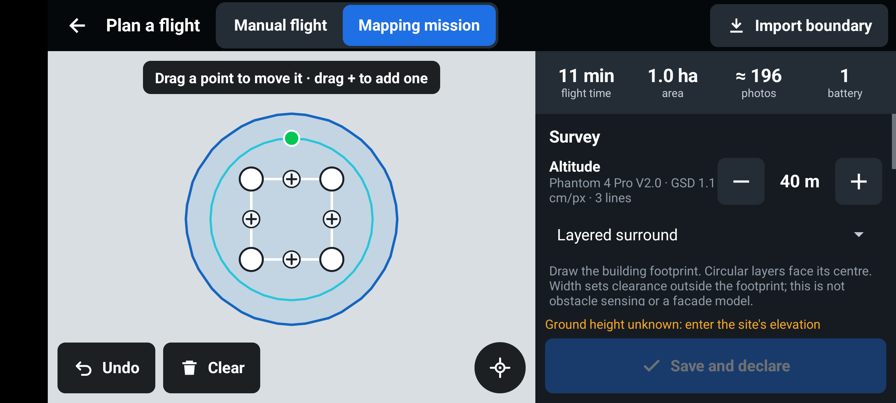

# Survey expansion and Mini 2 validation

As of 19 October 2026, version 0.5.0 development. This work expands capture planning and introduces an explicitly opted-in Mini 2 test executor. It does not establish operational qualification or feature parity with DJI Pilot 2/Rainbow. The immediate target confirmed by the programme owner is **Mini 2 and Flight Blender network reporting**. Broadcast Remote ID is out of scope.

## Research and scope

The supplied expanded Rainbow technical investigation distinguishes product/manual claims from inferred implementation. We received that investigation, not the original 89-page manual or Rainbow source. No proprietary Rainbow code or assets are used. Our implementation uses existing OpenUTM code, public DJI interfaces and independent geometry/control code under the repository's Apache-2.0 licence. DJI SDK binaries remain subject to DJI's own terms; see THIRD_PARTY_NOTICES.md.

An onboard waypoint exclusion does not make automated flight impossible: Virtual Stick is a different execution path. Conversely, SDK connectivity does not imply that an aircraft/controller/firmware supports every function. RC 2 file transfer is not third-party APK support. We cannot promise support for every DJI aircraft.

Primary references checked during this work:

- [DJI v4 FlightController and Virtual Stick controls](https://developer.dji.com/api-reference/android-api/Components/FlightController/DJIFlightController.html): v4 ground coordinates map pitch to east/west and roll to north/south.
- [DJI v5 Virtual Stick](https://developer.dji.com/api-reference-v5/android-api/Components/IVirtualStickManager/IVirtualStickManager.html): a separate API, with recommended command frequency and conditional authority/obstacle behaviour. No v5 Virtual Stick executor is added here.
- [Mini 2 specifications](https://www.dji.com/support/product/mini-2): 83-degree diagonal field of view and 4000×3000 4:3 imagery. Our camera profile is derived from those figures; it is not camera calibration.
- [DJI Assistant consumer release notes](https://dl.djicdn.com/downloads/dji_assistant/20250917/DJI%20Assistant%202%20%28Consumer%20Drones%20Series%29%20Release%20Notes%282.1.37%29.pdf) list Mini 2 log export, without the simulator entry listed for some other models. [DJI's SDK simulator tutorial](https://developer.dji.com/mobile-sdk/documentation/android-tutorials/SimulatorDemo.html) documents the separate Mobile SDK simulation API. Treat support as unverified until the connected Mini 2 acknowledges it and reports simulator-active state; installing Assistant alone is insufficient.
- [Rainbow model selection](https://www.flydji.net/drones.html) and [release history](https://www.flydji.cn/downloadv5beta.html): product evidence, not proof of its private navigation implementation.

## Implemented in this change

| Capability | Implementation and limits |
|---|---|
| Five-direction capture | Nadir plus four fixed-heading oblique passes, with pitch changes rendered to v4 and WPML. Nadir-derived GSD/spacing; no guarantee of full 3D object coverage or reconstruction. |
| Corridor capture | An open centreline drawn on the map or imported as KML/KMZ LineString; configurable full width and parallel offset strips. Sharp hairpin turns are refused. Review bends, cross-strip connectors, terrain and the declared area. |
| Layered surround | Circular layers outside a drawn footprint, adjustable stand-off, top height and layer spacing. Heading faces the footprint centre; pitch is pilot-selected, not dynamic 3D POI targeting. No obstacle sensing. |
| Concave area routes | Scan lines split at each polygon crossing. A visibility graph connects strips within the simple polygon instead of bridging recesses. Self-crossing boundaries are refused. |
| KML holes | Explicitly rejected rather than silently ignored. Split excluded areas into separate safe plans; holes are not supported. |
| Saved plans | Save/load named planning inputs locally and import/export versioned JSON through Android file pickers; deletion needs confirmation. Reloading recomputes against the current camera and lab height limits. A saved plan is not a declaration or permission. |
| Camera pitch interchange | Optional pitch changes survive mission serialization, v4 mapping, WPML generation and terrain interpolation. WPML distance-photo runs exclude intermediate transit vertices. |
| Mini 2 stop-and-shoot | An experimental v4 executor samples photo locations along survey legs, holds for capture, waits for the camera's new-file report and preserves original waypoint progress for resume. Native mission upload is not used. |
| Network diagnostics | Fly menu → OpenUTM network reporting shows connectivity, aircraft telemetry freshness, declaration acceptance and queued samples. Existing per-flight recording, backfill and closure stay in the Flight Blender pipeline. |
| Validation | Reject non-finite/invalid waypoint inputs, invalid photo spacing, oversize plans and unsupported saved-plan versions/identifiers. Unknown mapping cameras are not silently treated as the default camera on a connected aircraft. |

## Operator planning workflow

1. Open Plan → Mapping. Choose Grid, Crosshatch, Perimeter, Five-direction, Corridor or Layered surround.
2. For an area/surround, draw the footprint. For a corridor, draw ordered centreline points; choose Corridor before importing a LineString.
3. Set altitude, overlap, speed, direction, camera angle and optional travel altitude. For corridor set full width; for surround set stand-off, top altitude and layer spacing.
4. Inspect the **whole route**, including connectors and approaches. Estimated duration/photos/batteries are planning aids. Experimental Mini 2 displays cruise time as a lower bound, with stops extra, and leaves battery requirements unestimated. Plan conservatively and validate with measured flights.
5. Choose Save plan and a name if the geometry will be reused. Saved plans contain location data and remain in app-private storage. Do not uninstall or clear app data to update the app.
6. Saved plans → select an entry to load, or long-press to export/delete. A changed/unknown connected camera blocks mission upload until replanning. Recheck aircraft/camera, all settings, takeoff point, identity, dates, zones and approvals before declaring. Deletion has a separate confirmation and removes only the saved plan; flight records are separate.

KML/KMZ input still imports **geometry**, not a complete DJI Fly/Pilot 2 mission with preserved actions and heights. Saved plans can import/export the versioned OpenUTM JSON format through Android file pickers. Open Saved plans → Import plan, or long-press an entry → Export. An imported copy receives a fresh identifier and never overwrites a local entry. This is not a Rainbow project or full DJI WPML importer.

### Planner examples

These are synthetic Android replay examples, using the simulator's Phantom 4 Pro camera profile. No offline basemap is installed in these captures. They show route geometry and controls, not real flight or Mini 2 acceptance evidence. The missing ground elevation intentionally keeps declaration blocked.





## Mini 2 experimental execution

Ordinary debug and all release builds keep Mini 2 automatic execution **disabled**. The opt-in is a developer build flag, not a pilot-facing toggle or a qualification certificate:

```sh
./gradlew :app-v4:assembleDjiDebug -Popenutm.experimentalMini2=true
```

The SDK-neutral executor and controller guards can be tested on the JVM. The DJI adapter only offers this path for exact Mini 2 model names and only when the debug build opts in. Mini SE, Air 2S, other consumer products and all v5 Virtual Stick targets remain unqualified/disabled.

The experimental procedure requires manual takeoff and airborne GPS hold before Go. It does not arm motors or take off. Camera preparation selects still-photo mode, 4:3 framing and single shots. It changes the gimbal angle during capture. These changes have not been exercised on a physical Mini 2 in this work.

Current conservative guard values:

- Commands scheduled about every 100 ms; control-loop gaps or aircraft telemetry age over 500 ms abort. Monotonic time is used.
- Up to 3 m/s horizontal, 1 m/s vertical and 15 degrees/s yaw. Translation waits for height/heading alignment.
- A 200 m radius around the aircraft's position when the operator starts; mission targets 5–120 m above takeoff; maximum session 30 minutes. These are test envelopes, not country operating limits.
- GPS signal level at least 4, known battery above 25%, valid position/height/yaw, observed command authority and neutral physical sticks. RC-loss action must be verified as RTH, and the observed return height must be between the route ceiling and its 10 m declared margin (no higher than 120 m). Unknown settings block start; the executor does not silently rewrite them.
- Pilot stick movement, RTH/failsafe, authority loss, stale/invalid telemetry, lost photo acknowledgement, lack of navigation progress for 15 seconds (excluding intentional holds), and command errors interrupt. No automatic reacquisition or restart after override.
- Commands, camera actions and completion RTH are bound to the acquired aircraft instance; reconnecting another product must not redirect the active session. Disconnect clears cached control telemetry and battery state. A lost connection does not count as a confirmed control release.
- Pause holds while the controller remains healthy. Stop/cancellation attempts to release authority and reports an unconfirmed release as an interruption. Interrupted missions can be resumed through the existing original-waypoint checkpoint process, after pilot review and a fresh start.
- Stop/error cleanup attempts zero velocity only while fresh state says the app still owns control and no pilot override is present; then releases Virtual Stick. This is **not a guaranteed RTH**. Normal completion releases control and requests RTH when the mission's finish action is GO_HOME. Only RTH/hover finish actions are accepted.
- Every photograph needs a camera new-file acknowledgement; an SDK trigger callback alone is not treated as a saved image. Capture timeout interrupts the mission.

The app remains dependent on its process, controller connection, callback delivery and SDK behaviour. Mini 2 has no forward obstacle sensing. Firmware failsafe, flight-mode authority, RC pause/RTH buttons, camera acknowledgement, axis directions and reliable control rate must all be confirmed physically. Do not infer reliability from an APK build or unit tests.

### Developer SDK simulator bench

The `djiDebug` variant includes a shell-protected `Mini2BenchActivity`. It is absent from release and simulation APKs. Open the app normally first and grant its permissions, then open this activity from an authorized developer connection:

```sh
adb shell am start -n org.openutm.djiflight.v4/org.openutm.djiflight.app.v4.Mini2BenchActivity
```

The screen reads model/firmware, camera/mission support, stick values, Virtual Stick keys, RTH/failsafe settings and SDK simulator-active status. It does not log serial numbers, credentials or the real position. It has **no takeoff, motor, camera or Virtual Stick commands**. It defaults to read-only, hiding simulator controls. A developer preparing a separate props-off simulation session must explicitly add `--ez allow_simulator true` when opening it. Simulator start/stop then requires an on-screen action, confirmation that propellers are removed, Mini 2 identification, grounded state and motors off. A callback error or unknown active status is not a successful virtual flight.

Starting simulation also requires development-token setup pointing to a loopback development Blender (`localhost`, `127.0.0.1`, `::1` or emulator host `10.0.2.2`). On a phone, a developer can use `adb reverse tcp:8000 tcp:8000` and a build configured with `-PBLENDER_URL=http://127.0.0.1:8000`. Keep simulation on this local setup; never submit synthetic missions to Panama or another operational deployment. Stop simulation while grounded with motors off and verify inactive status **before** changing setup or returning to real operations. The bench screen does not automatically stop the simulator when leaving it.

Assistant's desktop simulator, the Mobile SDK simulator on a connected aircraft and our DJI-free Android replay APK are distinct tools. A successful replay or KMZ validation does not establish Mini 2 simulator support, motor isolation or real-flight performance. SDK simulation may also lack actual image-file events; the capture guard must remain enabled and stop on missing acknowledgements.

## Qualification gates

Record aircraft/controller/firmware/Android/page size/app version for every run. A pilot must control physical tests; this implementation work has not flown or commanded a real aircraft.

1. **Props off:** ordinary build cannot expose automatic Mini 2 missions; opted-in build identifies the model/profile. Verify telemetry freshness and raw stick values, camera modes and new-file events, authority acquisition/release, stick/RTH/mode overrides and callback timing. Do not bypass an absent SDK key to force availability.
2. **DJI-supported simulation/bench, if supported by the exact aircraft:** verify north/east/up/yaw signs, clamps, deadline failures, missing-photo abort, pause/resume, app cancellation and connection loss. If Mini 2 simulation is unavailable, record that and agree a qualified test plan rather than marking the gate passed.
3. **Supervised open-area flight:** manual takeoff; hold at a safe height; short straight route, then rectangle; compare actual track and image metadata. Establish drift/capture performance and reliable pilot takeover before enabling surveys.
4. **Small survey:** grid then corridor; check complete image coverage, stop-and-shoot duration, battery reserve, interrupted segment recapture and Blender counts/altitudes/timestamps during online/offline transitions.
5. **Oblique/surround and field acceptance:** validate camera alignment, payload geometry, terrain and dataset quality before clearance. Each new aircraft/controller/firmware path needs its own acceptance evidence.

## Remaining gaps and delivery order

| Area from the investigation | Current status | Next acceptance requirement |
|---|---|---|
| Mini 2 virtual navigation | Implemented as an opted-in experiment | Physical qualification above; no production enablement yet. |
| Other Virtual Stick aircraft/v5 | Not implemented | Per-device capabilities, separate SDK adapter and equivalent safety tests. |
| Full waypoint/action/3D POI editor | Partial core primitives; no complete editor | Per-waypoint heights, wait/video/rotation actions, POI aiming and capability checks. |
| Slope/facade/prism inspection | Not implemented | Surface geometry, stand-off/coverage, transit and collision review. Surround is not a substitute. |
| Robust interchange | Geometry import and versioned saved-plan codec | Preserved WPML parameters, tested target-specific KMZ export and DJI Fly handoff. No universal RC 2 promise. |
| Survey camera readiness | Mini 2 selects still/4:3/single, waits for image files | Measured shutter latency/blur limits, exposure/RAW/JPEG/lens validation, SD capacity and dataset QA. |
| Panorama/hyperlapse/media | Existing basic SDK widgets; no complete workflow | Capture orchestration, storage/download, stitching/rendering and recovery. |
| GPS follow, visual tracking, locks, VR | Not implemented | Separate feedback-control and override validation; do not expose navigation modes by model name alone. |
| Find drone, replay, voices/units, RC shortcuts | Logs/exports exist; dedicated workflows missing | Recovery/privacy design, SDK support matrix and operator UI acceptance. |
| Photogrammetry | External handoff only | Choose/validate a processing integration and dataset quality; a capture path is not a reconstructed model. |
| Flight Blender/OpenUTM | Existing declarations, network telemetry, backfill/closure and local contract tests | Retain regression coverage; verify each hosted environment and hardware timing/altitude references. No blanket regulatory certification claim. |
| Broadcast Remote ID | Explicitly excluded by programme direction | No broadcaster or compliance status added. |

The next release decision must use measured Mini 2 evidence, not a comparison checklist alone. Broader product parity remains this backlog; it is not represented as completed functionality.

## Software verification and physical-test status

Verification on 19 October 2026: **137 JVM tests passed** (125 core, 12 replay/adapter), with no skips, failures or errors. Seven of those exercised the local Flight Blender. `app-v4:assembleSimDebug`, `app-v4:assembleDjiDebug` and `app-v5:assembleDebug` built successfully; shared/v4/v5 debug lint reported no errors (warnings remain). The opted-in debug build was also built and linted; generated configuration confirmed `MINI2_SURVEY_EXPERIMENTAL=true` only for that opted-in debug build, and `false` for release even with the opt-in property present.

The software checks cover geometry and concave connectors, invalid saved-plan imports, inherited camera pitch across upload parts/checkpoints, camera mismatch, control axes/clamps, telemetry deadlines, pilot override, pause/cancellation, RTH/failsafe readiness, failed control release and missing image acknowledgement. Local Flight Blender integration exercises declaration, network reporting, retry/backfill and closure; no production Panama service is used for simulated flights.

DJI's native `wpmzsdk` validator/parser ran on an ARM64 Android 14 emulator for 14 fixtures: M3E, M400/P1, M3T, M3M, M400/H30, M400/H30T, crosshatch, perimeter, five-direction, corridor, surround, terrain-follow, a terrain upload part, and waypoint photographs. Every fixture returned an empty validation-error list and parser error value 0. This validates file structure, not aircraft or payload execution.

Android replay smoke checks opened corridor and surround routes and the saved-plan library. A debug fixture also passed the Android URI import/export handlers, verifying that import creates another entry and export preserves the saved inputs. This does not exercise every external document provider. The screenshot fixture is `simDebug` only, protected by Android's DUMP permission, and never starts or declares a flight.

**Physical status:** no aircraft has been flown or given flight-control commands during this implementation. The owner currently cannot remove propellers. Any available connected bench check is therefore restricted to read-only connection, telemetry, model/firmware and SDK key availability. SDK simulation, authority acquisition, motors, camera writes and automatic navigation remain outside that check. Mini 2 release execution stays disabled.
