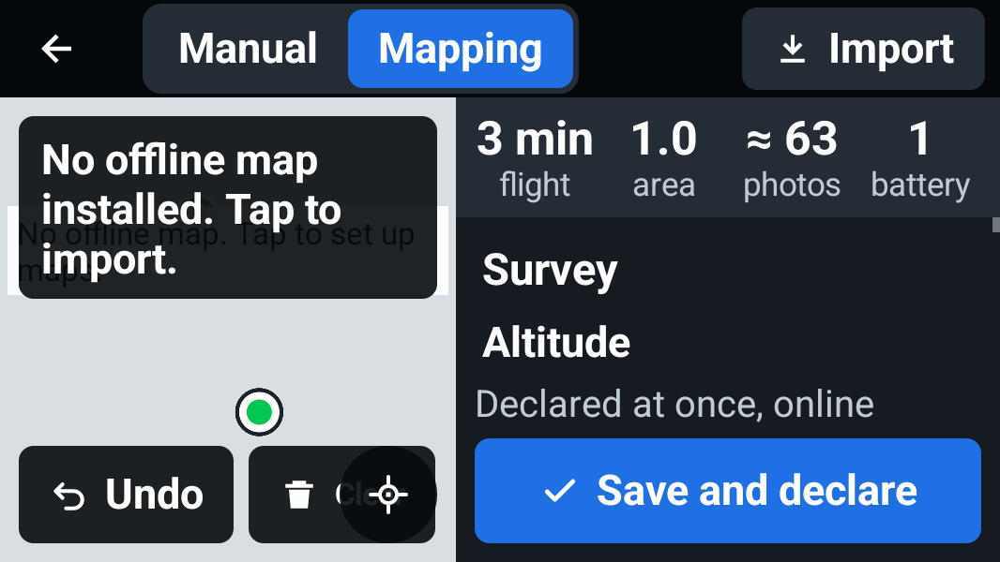
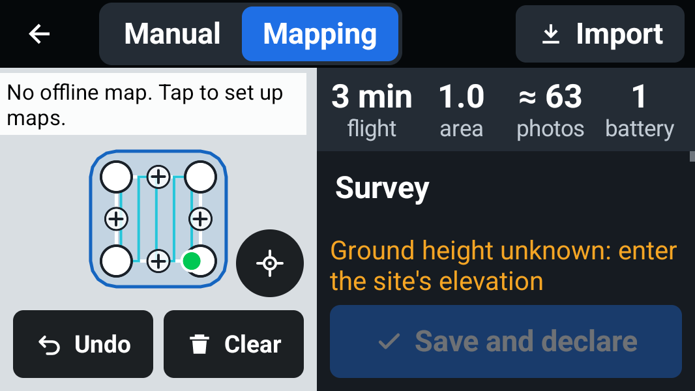
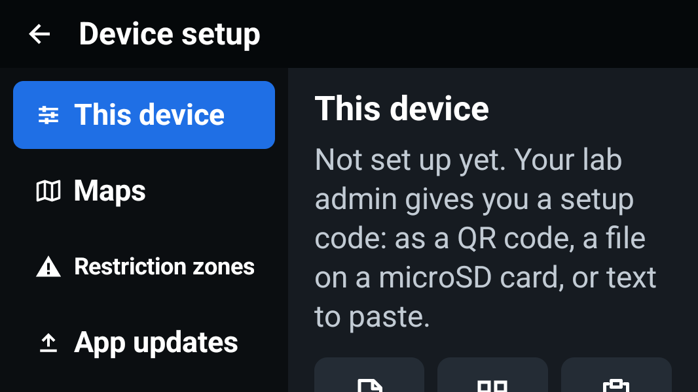
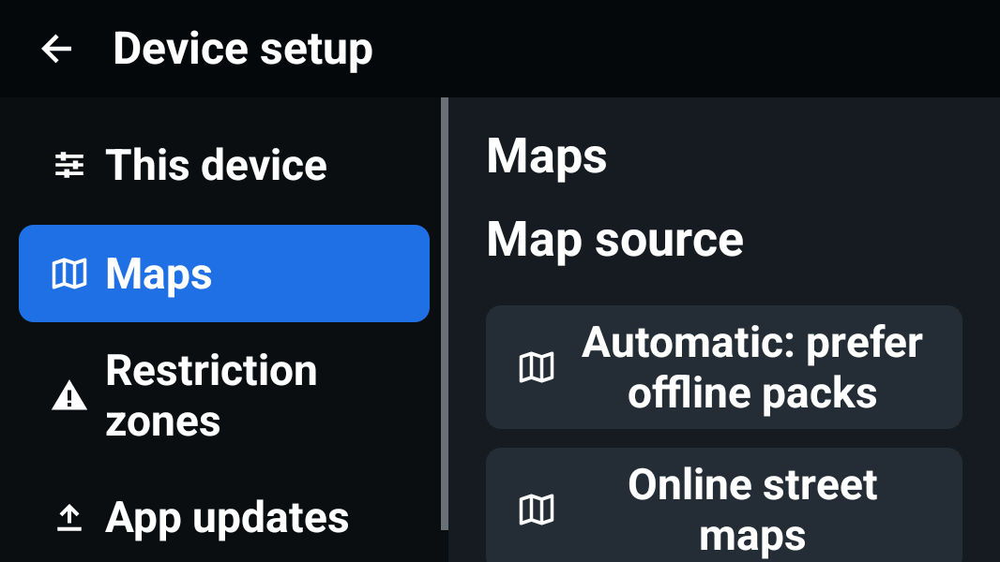
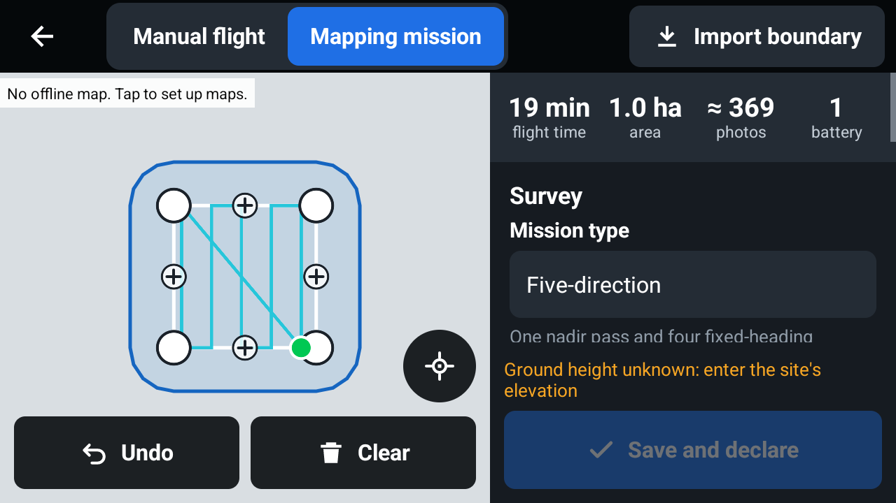

# Android UI and UX audit

Audit date: 20 October 2026. Baseline: 0.6.1; repairs: 0.6.2.

This is a screen and component audit, not flight qualification. Shared screens were checked in an isolated Android 14 simulator, with a non-routable backend (`127.0.0.1:9`) and offline-only maps. The OnePlus Nord CE was used for read-only v4/v5 checks. No aircraft controls, calibration, capture, production declarations or telemetry submission were used.

## Findings and repairs

Priority: **P2** affects readability, navigation or correct status interpretation; **P3** is an avoidable usability problem.

| Priority | Component and trigger | Baseline problem | Repair |
|---|---|---|---|
| P2 | Map labels after layout | Unconditional size setters repeatedly request layout, keeping the UI busy. The first-run smoke test stalls waiting for idle. | Update label widths and status clearance only when their values change. |
| P2 | Plan, compact landscape and 150% text | Clear overlaps Recenter. | Undo/Clear share the available map width; Recenter has its own row above them. |
| P2 | Plan without an offline pack | Two missing-map banners overlap. A wrapped instruction can also cover map-source status. | One actionable missing-map banner; other map status reserves the measured instruction height. |
| P2 | Plan, short display and larger text | Fixed estimates and footer squeeze the editable form to a thin strip. Stepper hints wrap in a narrow column beside the number controls. | Estimates scroll with the form; constrained stepper rows place labels above controls. The declaration action and validation message remain pinned. |
| P2 | Setup navigation, short display or larger text | Fixed navigation has no scroll path; long labels shrink instead of respecting the selected font size. | Scrollable navigation, font-aware width and two-line labels; setup action labels wrap at their requested size. |
| P2 | Setup/status rows with long labels or URLs | An unrestricted label can consume the value's entire width. | Both columns have bounded widths and wrap. |
| P2 | v5 Fly with no available camera | Camera controls and UNKNOWN readouts appear over a black preview; a late SDK callback can expose stale controls. | Hide camera controls until a matching camera is available, disable focus interaction on disconnect and handle either callback order. |
| P2 | v5 camera storage | Invalid capacity is displayed as −1 MB. Source inspection also found that SD capacity can overwrite internal-storage capacity even when internal storage is selected. | Invalid capacity displays N/A; capacity comes from the selected storage medium. Connected dual-storage behaviour still needs enterprise hardware validation. |
| P2 | v5 settings | The Close hit area exists, but its font icon is blank on the OnePlus. | Use a packaged Close drawable and an accessibility label. |
| P3 | Empty Flights history | Half the screen is blank; cleanup remains active, with no useful next action. | Full-width empty state, a Setup/Plan action and disabled empty cleanup. |
| P3 | Map setup | Explanatory text precedes the map-source choices and pushes them below the fold. | Show source choices before the provider explanation. |
| P2 | Mapping setup order | Mission type follows altitude; a fallback camera can look confirmed while disconnected. | Choose mission type before altitude; label an unconfirmed planning camera explicitly. |
| P3 | Survey-pattern dropdown | Uses the stock dropdown instead of the shared styled selector. | Use the same closed and popup rows as pilot/aircraft selection. |
| P3 | Fly status bar | UTM pill touches the first aircraft indicator. | Add a gap within the measured status allocation. |

### Compact Plan comparison

533 × 300 dp landscape, 150% system text. The aircraft and area are simulator fixtures. The grey map is intentional: public tile requests are disabled for automated testing.

Before:

After:

### Setup comparison

Before:

After:

## Comparison with the supplied Pilot 2 guide

The [Propeller 3D oblique planning guide](https://help.propelleraero.com/hc/en-us/articles/19384415429911-How-to-Plan-a-3D-Oblique-Mission-with-DJI-Pilot-2) separates route creation, capture settings, camera setup and preflight review. Its camera advice depends on the aircraft/payload. We use it as a workflow reference, not as a Mini 2 flight preset.

| Workflow consideration | OpenUTM finding and next step |
|---|---|
| Choose capture type early | Mission type now precedes altitude and retains its plain-language capture hint. |
| Camera and lens affect planning | Connected SDK profiles supply the camera; a fallback is now marked unconfirmed. Offline camera/lens selection remains a gap. |
| Nadir plus oblique coverage | Five-direction geometry includes a nadir pass and four tilted fixed-heading passes. It still needs coverage and execution validation for each supported aircraft. |
| Separate regular/oblique overlap | OpenUTM has one front/side pair; separate pairs are not implemented. |
| Ortho/oblique resolution | Current GSD and spacing use the nadir camera model. Oblique surface resolution is not calculated. |
| Smart Oblique | No equivalent automatic multi-angle capture mode is implemented. |
| Camera setup and preflight | Vendor camera settings exist, but there is no consolidated survey-quality review of focus, shutter, image format and mission settings. This is a priority for a further planning-flow redesign. |

The layout repairs do not establish full DJI Pilot 2 feature parity or survey-output accuracy.

## Follow-up work

- **P2 — Spanish UI is not translated.** Selecting Spanish changes locale-dependent numbers, but app labels fall back to English. English/Spanish onboarding documents do not provide a Spanish app UI. Add reviewed `values-es` resources before describing the app as bilingual.
- **P2 — Accessibility remains incomplete.** Setup and stepper improvements do not make the whole app accessible. Other `ActionButton` callers still permit text fitting down to 11 sp; menu/sheet actions need a broader layout pass, and vendor icon-only controls need a TalkBack audit. Do not claim 200% text or screen-reader support from these checks.
- **P2 — Enterprise reconnection and payload coverage.** Disconnected v5 screens can be checked on the OnePlus; connected camera switching, RTK, multispectral/zoom payloads, storage switching and reconnect ordering need supported v5 equipment. Mini 2 cannot validate those paths.
- **P3 — Dense Plan layout.** Short displays still require scrolling through the form. A dedicated full-screen editor would improve comfortable use at extreme text/display sizes; do not shrink text to force every field onto one screen.

## Validation and limits

- 156 JVM tests report zero failures/errors: 139 core, 12 replay/Blender integration and 5 map-source/HTTP tests. Core/adapter code is unchanged in this UI patch; Gradle reused those passing results. Shared tests passed again after the final changes.
- Both signed 0.6.2/code 11 releases built; shared debug and both release lint tasks passed without errors. Existing vendor `org.dom4j` warnings remain.
- The signed v4 first-run instrumentation passed on the isolated Android 14 device: Panama default, no personal identity, masked secret, missing-pilot validation before connection, JourneyApps QR launch/cancel, and checklist expansion from the camera inset while preserving the SDK view tree.
- The earlier smoke run stalled waiting for UI idle because map label setters caused continuous layout passes. After the repair, the same test completed without changing the test, and logs showed only bounded initial layout adjustments.
- Shared Plan and Setup were rendered at 640 × 360 dp/100% text and 533 × 300 dp/150% text. Grid, corridor and five-direction fixtures, navigation scrolling, missing-map behaviour and stepper layout were inspected. Spanish locale fallback was checked; this was not a Spanish translation test.
- On the OnePlus, read-only checks confirmed the v4 aircraft-status panel opens/closes, the device setup form and map page remain readable, the v5 disconnected screen hides camera controls, and the v5 settings Close icon is visible and dismisses the panel. No connected enterprise aircraft, payload switching or aircraft operation was qualified.
- The signed v4 empty-history screen was checked on the emulator: the detail fills the available width, setup is offered and cleanup is disabled.
- Both final APKs were installed over the existing phone apps without clearing data. Their installed SHA-256 values match the downloadable files. Signatures, version metadata and absence of private device setup were verified.

These repairs do not enable automatic Mini 2 missions or establish DJI Pilot 2 feature parity. They cover the screens and states above; TalkBack, 200% text, every controller resolution and every vendor panel remain outside this validation.
